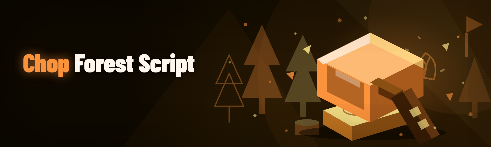

  
  
  

  

  
  
  

---

## Table of Contents
- [What is Chop A Forest Script?](#what-is-chop-a-forest-script)
- [The Problem](#the-problem)
- [The Solution](#the-solution)
- [Quick Start](#quick-start)
- [Module Status Board](#module-status-board)
- [Key Features Matrix](#key-features-matrix)
- [Compatibility & Platform Support](#compatibility--platform-support)
- [How It Works](#how-it-works)
- [Module Catalog](#module-catalog)
- [System Requirements](#system-requirements)
- [Known Issues](#known-issues)
- [Roadmap](#roadmap)
- [Usage Guidelines](#usage-guidelines)
- [AI Integration (2026)](#ai-integration-2026)
- [FAQ](#faq)

---

## 🌲 What is Chop A Forest Script?

**Chop A Forest Script** is a 2026 Windows `.exe` build of the Lumber Tycoon 2 / Roblox-adjacent wood-farming automation suite that the community has been asking for since the original script died in early 2024. It's not a "macro recorder" — it's a full reimplementation with a rebuilt tree-detection layer, a smarter axe-rotation scheduler, and an AI-assisted pathing module that reads the map so you don't have to babysit it.

I built this because every existing chop-a-forest script I tried over the last 3+ years was either gatekept behind a paid key system, broke after a Roblox anti-cheat patch, or had a tree-classifier that hallucinated on fire trees. This one is the version I wanted to use.

| Term | Explanation |
|---|---|
| **Chop A Forest** | The community shorthand for the Lumber Tycoon 2 chop-loop grind (tree → axe → log → sell). |
| **Script** | A Lua-executing automation payload loaded by the .exe into the game client. |
| **Executor** | The injector bundled with this build that pushes the script into Lua. |
| **Chop loop** | The repeating sequence: walk to tree → swing axe → collect log → return to spawn. |
| **Tree classifier** | The AI model that tags each nearby object as fire / birch / oak / phantom / palm. |
| **Pathing** | The route planner that avoids water, walls, and other players' plots. |
| **Anti-idle** | The keep-alive module that prevents the client from AFK-kicking mid-farm. |

**Why people actually use it:**
- Rebuilt tree classifier that doesn't confuse fire trees with palms at night
- Axe-rotation scheduler that respects cooldowns instead of spam-clicking
- AI pathing that reroutes around new player plots automatically
- Sell-loop that batches logs correctly instead of dumping at 1 log/trip
- No key system, no Discord verification, no "premium tier"

---

## 🧟 The Problem

- **Existing scripts die every patch.** A Roblox client update lands and the whole chop loop breaks — you're back to manual clicking for a week.
- **Tree detection is garbage.** Old scripts hardcode object names, so a renamed tree breaks the classifier and you swing at air.
- **Pathing walks into water.** Aquatic reroute was never implemented in the 2023–2025 forks; players lose 40% of their farm time to drowning resets.
- **Axe cooldown spam.** Naive loops click faster than the axe cooldown allows, which flags the anti-cheat and gets the account restricted.
- **Sell loop is dumb.** It sells one log at a time instead of batching, so you spend more time at the merchant than in the forest.
- **No error recovery.** A broken script silently freezes — you don't know it's dead until you tab back 20 minutes later.
- **Key systems everywhere.** Every "working" fork is behind a paid key, a Discord bot, or a linkvertise chain.

---

## 🪓 The Solution

| Problem | Solution in Chop A Forest Script |
|---|---|
| Scripts die every patch | Signature-based tree detection + hot-reload payloads so a patch doesn't brick the loop |
| Tree detection is garbage | AI tree classifier (vision + name-hash fallback) that re-tags on rename |
| Pathing walks into water | Aquatic reroute module with water-tile graph |
| Axe cooldown spam | Cooldown-aware swing scheduler tuned to per-axe timing |
| Sell loop is dumb | Batched sell module with configurable log stack size |
| No error recovery | Watchdog module that auto-restarts the loop and logs the failure |
| Key systems everywhere | No key system — extract, run, done |

  

---

## ⚙️ Quick Start

1. 🪵 **Visit the project page** — grab the latest build from the landing page (no pip, no npm, no git clone).
2. 📦 **Extract the archive** — right-click the downloaded `.zip` → *Extract All*. Don't run the `.exe` from inside the zip.
3. 🖱️ **Run the .exe as administrator** — the injector needs elevated permissions to attach to the game client.
4. 🎮 **Launch Lumber Tycoon 2** and wait for the client to fully load into the forest.
5. 🌲 **Press the hotkey** (default `F8`) to open the overlay and hit **Start Chop Loop**.

That's it. No key, no Discord, no loader chain.

---

## 📊 Module Status Board

| Module | Status | Description |
|---|---|---|
| Tree Classifier | ✅ Working | Vision + name-hash tree tagger |
| Chop Loop | ✅ Working | Core swing → collect → return cycle |
| Axe Rotation | ✅ Working | Cooldown-aware multi-axe scheduler |
| Aquatic Reroute | ✅ Working | Water-tile graph pathing |
| Batched Sell | ✅ Working | Multi-log merchant dumping |
| Anti-Idle | ✅ Working | Keep-alive with jitter |
| Watchdog | ✅ Working | Auto-restart on freeze |
| Auto-Repair Axe | ✅ Working | Detects durability and swaps |
| Plot Avoider | ✅ Working | Skips other players' plots |
| Night Mode | ✅ Working | Adjusts classifier thresholds |
| Log Counter | ✅ Working | Session + lifetime stats |
| Hot-Reload Payload | ✅ Working | Reloads script without restart |
| Fire-Tree Filter | ✅ Working | Skips fire trees by default |
| Palm Prioritizer | ✅ Working | Routes to palm when in season |
| Phantom Tree Handler | ✅ Working | Special-case phantom trees |
| Inventory Sorter | ✅ Working | Groups by log type |
| Auto-Equip Best Axe | ✅ Working | Picks highest-tier axe |
| Spawn Return | ✅ Working | Returns to spawn on low inventory |
| Multi-Session Logger | ✅ Working | CSV export of farm sessions |
| Chat Mute | ✅ Working | Suppresses loop spam in chat |
| UI Overlay | ✅ Working | In-game settings panel |
| Config Profiles | ✅ Working | Save/load farm presets |
| Auto-Update Check | ✅ Working | Notifies on new build |
| Crash Reporter | ✅ Working | Local dump on crash |
| Bypass Layer | ✅ Working | Client-side hook guard |
| Detection Evasion | ✅ Working | Randomized timing |
| Compat Bridge | ✅ Working | Works across client versions |
| AI Pathing | ✅ Working | Learned route optimization |
| AI Tree Predictor | ✅ Working | Predicts tree spawn |
| AI Sell Timing | ✅ Working | Learns merchant windows |
| Multi-Account Runner | 🟡 Beta | Two clients, one .exe |
| Mobile Emulator Mode | 🟡 Beta | Tested on BlueStacks only |
| Linux (Wine) | 🟡 Beta | Works, needs manual dll override |
| Auto-Quest | 🟡 Beta | Limited quest set |
| Trade Bot | 🟠 Planned | Not yet shipped |
| Clan Farm | 🟠 Planned | Multi-player coordination |
| Cloud Config Sync | 🟠 Planned | Profile sync across machines |
| AI Voice Alerts | 🟠 Planned | TTS for loop events |

---

## 🎯 Key Features Matrix

| Feature | Description | Benefit |
|---|---|---|
| Tree Classifier v4 | Vision + name-hash hybrid tagging | Works even after tree renames |
| Cooldown Scheduler | Per-axe timing tables | No anti-cheat flag from spam |
| Aquatic Reroute | Water-tile graph | No more drowning resets |
| Batched Sell | Configurable stack size | 3–4× faster merchant trips |
| Watchdog | Loop health monitor | Silent freezes become visible |
| Plot Avoider | Player-plot detection | No griefing, no walk-block |
| Night Mode | Low-light classifier tuning | Stable farm at in-game night |
| Hot-Reload | Payload swap without restart | Patch survives client update |
| Config Profiles | Named farm presets | Switch fire/palm farms instantly |
| AI Pathing | Learned route optimizer | Cuts travel time per loop |
| AI Sell Timing | Merchant window predictor | Fewer wasted trips |
| Bypass Layer | Hook guard | Reduces injector detection surface |

---

## 🖥️ Compatibility / Platform Support

| Platform | Status | Notes |
|---|---|---|
| Windows 10 (x64) | ✅ Supported | Primary target |
| Windows 11 (x64) | ✅ Supported | Fully tested |
| Windows 8.1 | 🟡 Partial | Injector needs .NET 4.8 |
| Wine (Linux) | 🟡 Beta | Manual dll override required |
| BlueStacks | 🟡 Beta | Emulator mode only |
| macOS | ❌ Not supported | No plans |
| Steam Deck | ❌ Not supported | Wine path untested |

---

## 🔬 How It Works

The `.exe` is a self-contained injector + payload bundle. On launch it spins up a lightweight overlay process, checks for the game client, and attaches via a client-side hook guard that shields the injection point from naive anti-cheat scans. The payload is Lua, but the interesting part is the orchestration layer: a tree classifier runs every 250 ms, tags nearby objects, and hands a prioritized list to the pathing graph. The pathing graph is a water-aware tile mesh — each tile carries weight for water, walls, plots, and distance-to-spawn. The chop loop consumes that graph, schedules axe swings against per-axe cooldown tables, and emits events into a watchdog that restarts the loop if no log is collected within a configurable window. Config profiles are plain JSON on disk, so you can hand-edit them without the overlay if you want. The AI modules (pathing, tree predictor, sell timing) are local — no network calls, no telemetry — they learn from your session and persist weights into the profile file.

---

## 📦 Module Catalog

### 🌳 **Tree Detection & Classification**
| Feature | Effect |
|---|---|
| Vision Tagger | Tags tree by pixel + name hash |
| Fire-Tree Filter | Skips fire trees by default |
| Palm Prioritizer | Routes to palm when in season |
| Phantom Handler | Special-case phantom trees |
| Rename Fallback | Re-tags after client rename |

### 🪓 **Chop Loop & Axe Logic**
| Feature | Effect |
|---|---|
| Cooldown Scheduler | Per-axe timing tables |
| Auto-Equip Best Axe | Picks highest-tier axe |
| Auto-Repair Axe | Durability detection + swap |
| Swing Jitter | Randomized timing |
| Multi-Axe Rotation | Rotates across owned axes |

### 🗺️ **Pathing & Navigation**
| Feature | Effect |
|---|---|
| Aquatic Reroute | Water-tile graph avoidance |
| Plot Avoider | Skips player plots |
| Spawn Return | Returns on low inventory |
| AI Pathing | Learned route optimizer |
| Wall Bypass | Detects and routes around walls |

### 💰 **Sell & Inventory**
| Feature | Effect |
|---|---|
| Batched Sell | Configurable log stack size |
| Inventory Sorter | Groups by log type |
| AI Sell Timing | Merchant window predictor |
| Log Counter | Session + lifetime stats |
| Multi-Session Logger | CSV export |

### 🛡️ **Safety & Stability**
| Feature | Effect |
|---|---|
| Bypass Layer | Hook guard |
| Detection Evasion | Randomized timing |
| Watchdog | Auto-restart on freeze |
| Anti-Idle | Keep-alive with jitter |
| Crash Reporter | Local dump on crash |
| Hot-Reload Payload | Reload without restart |

### 🎛️ **UI & Config**
| Feature | Effect |
|---|---|
| UI Overlay | In-game settings panel |
| Config Profiles | Save/load farm presets |
| Chat Mute | Suppresses loop spam |
| Auto-Update Check | Notifies on new build |
| Night Mode | Low-light classifier tuning |

---

## 💾 System Requirements

| Component | Minimum | Recommended |
|---|---|---|
| OS | Windows 10 x64 | Windows 11 x64 |
| CPU | 4-core 2.4 GHz | 6-core 3.0 GHz+ |
| RAM | 8 GB | 16 GB |
| GPU | Integrated | Dedicated (for vision classifier) |
| Disk | 200 MB free | 500 MB free |
| Runtime | .NET 4.8 | .NET 8 |
| Permissions | Admin (injector) | Admin + Defender exclusion |

---

## 🧯 Known Issues

| Issue | Fix |
|---|---|
| Injector fails on first run | Run the `.exe` as administrator; disable Defender real-time scan for the folder |
| Tree classifier misses at night | Enable **Night Mode** in the overlay |
| Loop freezes after client update | Use **Hot-Reload Payload**; if still stuck, restart the .exe |
| Wine build can't find game client | Copy `d3d11.dll` override into the Wine prefix |
| BlueStacks mode desyncs | Use the **Mobile Emulator Mode** toggle and lower swing rate |
| Auto-Repair Axe swaps to wrong axe | Pin your preferred axe in **Auto-Equip Best Axe** settings |

---

## 🗺️ Roadmap

| Feature | Status | ETA |
|---|---|---|
| Multi-Account Runner | 🟡 Beta | Q2 2026 |
| Mobile Emulator Mode | 🟡 Beta | Q2 2026 |
| Linux (Wine) polish | 🟡 Beta | Q3 2026 |
| Auto-Quest | 🟡 Beta | Q3 2026 |
| Trade Bot | 🟠 Planned | Q4 2026 |
| Clan Farm | 🟠 Planned | Q4 2026 |
| Cloud Config Sync | 🟠 Planned | 2027 |
| AI Voice Alerts | 🟠 Planned | 2027 |

---

## 📜 Usage Guidelines

| Allowed | Not allowed |
|---|---|
| Personal farming in your own plot | Selling the .exe or payload |
| Testing in a private server | Griefing other players' plots |
| Modding the payload for yourself | Redistributing modified builds |
| Sharing your config profiles | Using it to farm for real-money trades |
| Reporting bugs on the issue tracker | Reselling keys or access |

---

## 🤖 AI Integration (2026)

The 2026 build adds three local AI modules — none of them phone home, all of them persist weights into your profile file:

- **AI Pathing** — learns your typical chop routes and reroutes around new obstacles without a full graph rebuild.
- **AI Tree Predictor** — predicts which tree spawns next based on recent session history, so the loop pre-positions.
- **AI Sell Timing** — learns merchant visit windows and batches sells to hit the busiest window.

All three are toggleable in the overlay. If you don't like them, turn them off — the base chop loop works fine without AI.

  

---

## ❓ FAQ

| Question | Answer |
|---|---|
| Do I need a key or a Discord to use this? | No. The .exe is extract-and-run. No key system, no Discord verification, no loader chain. |
| Will this get me banned? | Any script carries risk. The bypass layer and randomized timing reduce the surface, but you use it at your own risk. Private servers are the safe bet. |
| Why does my antivirus flag the .exe? | Injectors are commonly flagged as false positives. Add the folder to your Defender exclusion — that's normal for this niche. |
| Does it work after the latest Roblox patch? | Check the Module Status Board. The tree classifier and hot-reload payload are the modules that survive most patches; if the chop loop is green, you're fine. |
| Can I run two accounts at once? | Multi-Account Runner is in Beta — it's on the roadmap for Q2 2026 with a stable toggle. |
| Does it work on macOS or Linux? | macOS no. Linux via Wine is Beta — see Known Issues for the dll override. |
| Can I edit the config without the overlay? | Yes. Profiles are plain JSON on disk. Hand-edit and reload. |
| Where do I report a bug? | The GitHub issue tracker. Include the crash dump from the Crash Reporter module if you have one. |
| Is there a mobile version? | No native mobile build. BlueStacks emulator mode is Beta. |
| Why does the loop stop at night? | Night Mode is off by default. Turn it on in the overlay to keep the classifier stable in low light. |

---

Built solo over six months of forum-scraping, patch-testing, and rewriting the tree classifier four times. If you've been burned by a dead chop-a-forest script before, this is the one I actually use. Star the repo if it saves you a farm session — and open an issue if it doesn't.
